# Blue Coast OS — Production & Fabrication Management System

<p align="center">
  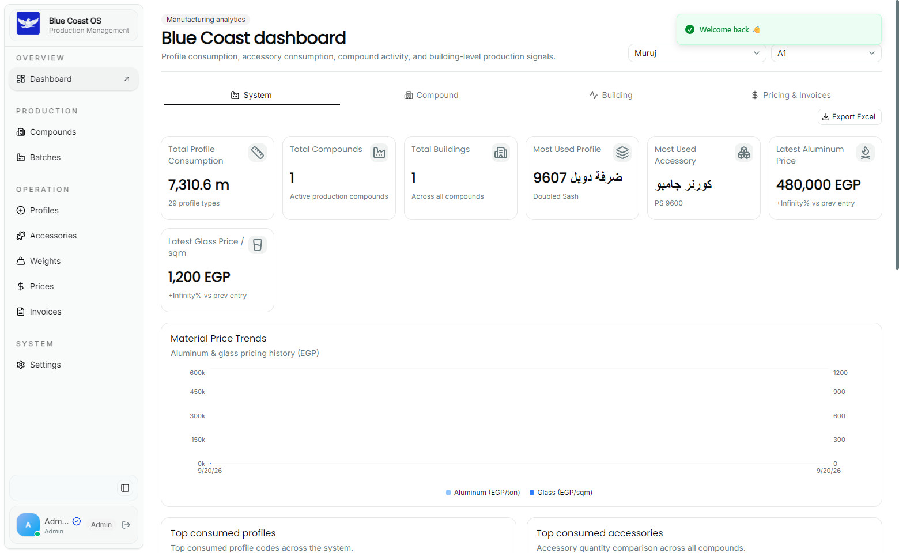
</p>

<p align="center">
  <strong>An advanced desktop application built for managing the industrial production, cut plan optimization, material inventory, and commercial quoting of aluminum windows and doors.</strong>
</p>

<p align="center">
  
  
  
  
  
  
  
</p>

---

## 📌 Table of Contents
- [Overview](#-overview)
- [Key Features](#-key-features)
  - [1. Executive Analytics & Dashboard](#1-executive-analytics--dashboard)
  - [2. Compounds & Site Hierarchy](#2-compounds--site-hierarchy)
  - [3. Cut Plan Batches & Fabrication Optimization](#3-cut-plan-batches--fabrication-optimization)
  - [4. Technical Inventory & Master Data](#4-technical-inventory--master-data)
  - [5. Pricing, Quoting & Invoices](#5-pricing-quoting--invoices)
  - [6. System Settings & Localization](#6-system-settings--localization)
- [Architecture & Tech Stack](#-architecture--tech-stack)
- [Getting Started](#-getting-started)

---

## 🔍 Overview

**Blue Coast OS** is an end-to-end manufacturing execution and financial planning platform engineered specifically for aluminum fabricators. It replaces manual spreadsheets and fragmented workflows with real-time analytics, automated bar cutting layouts that eliminate raw material waste, and an integrated pricing calculator tailored for architectural systems.

---

## 🚀 Key Features

### 1. Executive Analytics & Dashboard
The command center surfaces real-time metrics across raw material consumption, compound progress, and price fluctuations.

<p align="center">
  
</p>

- **Real-Time KPIs:** Linear meters of extrusion consumed, active compounds count, top profile codes, and leading hardware accessories.
- **Historical Price Trends:** Dual-trend visualization tracking market aluminum prices (EGP/ton) alongside flat glass rates (EGP/sqm).
- **Multi-Level Drill Downs:** Switch between global system views, specific compounds, or individual building structures.

<p align="center">
  
  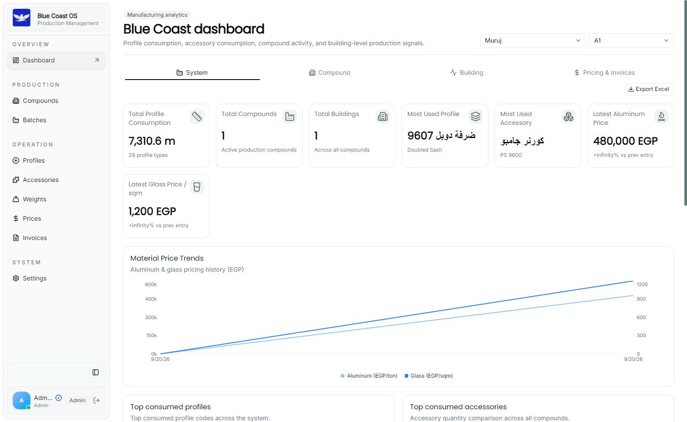
</p>

---

### 2. Compounds & Site Hierarchy
Structure manufacturing orders by project site, building blocks, and apartments.

<p align="center">
  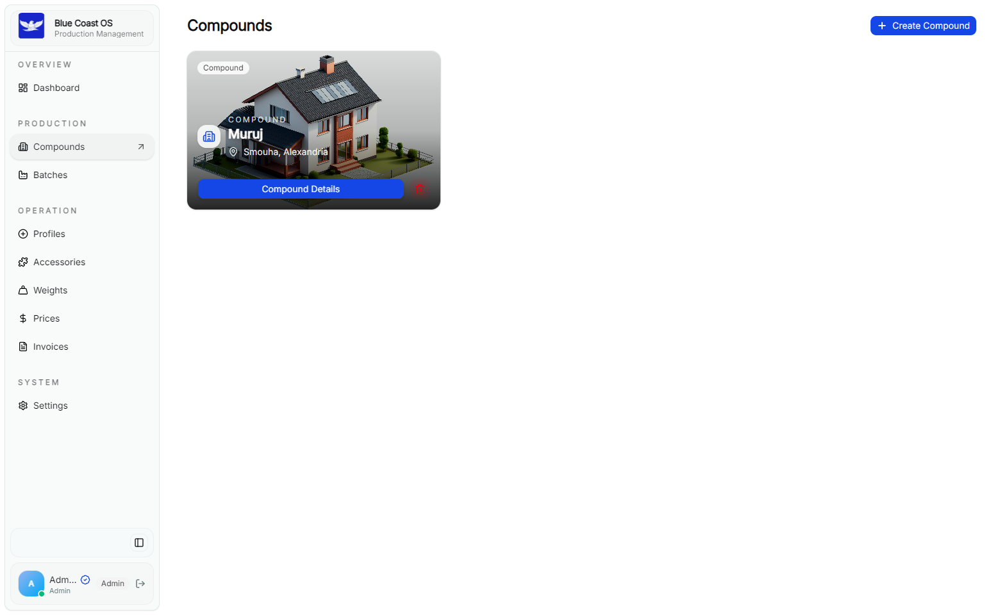
  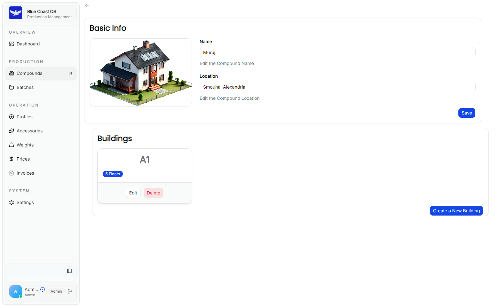
</p>

- **Project Master Catalog:** Browse all ongoing compound developments with location mapping.
- **Detailed Unit Hierarchy:** Break down compounds into individual buildings, floor layouts, and opening schedules.

---

### 3. Cut Plan Batches & Fabrication Optimization
Minimize scrap with automated cutting layouts and track fabrication progress across production stages.

<p align="center">
  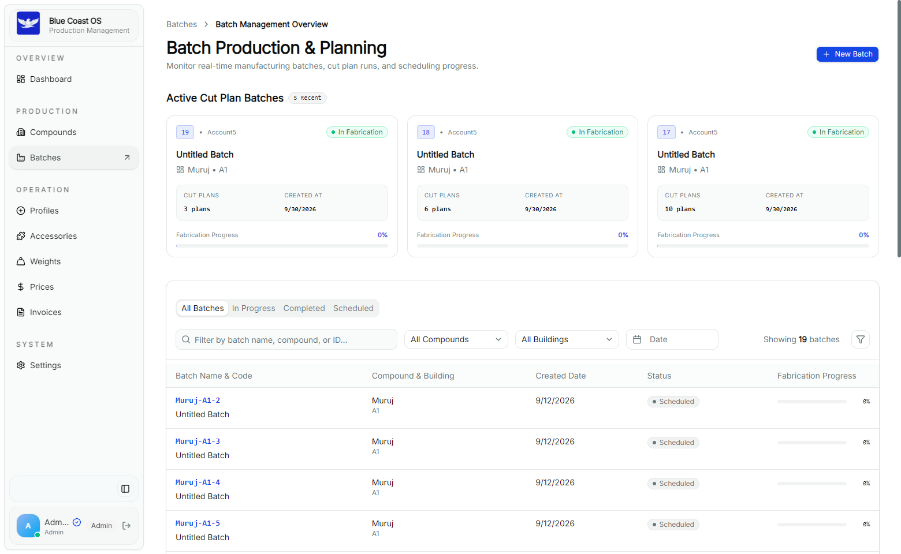
</p>

- **Batch Overview:** Monitor all batches categorized by status (`In Fabrication`, `Scheduled`, `Completed`).
- **Profile Efficiency Analytics:** Detailed bar utilization stats per profile (Interlock, Flyscreen, Double Sash, Frame, Architrave).
- **Waste & Scrap Calculation:** Immediate visibility into used linear meters vs. residual scrap percentages.
- **Physical Metrics:** Automatic sum of glass area ($m^2$), window unit area ($m^2$), and overall aluminum weight ($kg$).

<p align="center">
  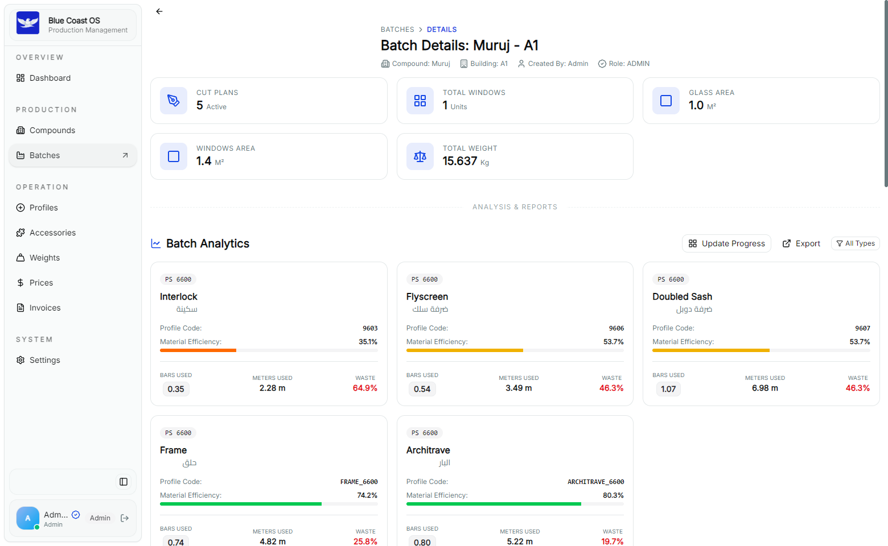
</p>

<p align="center">
  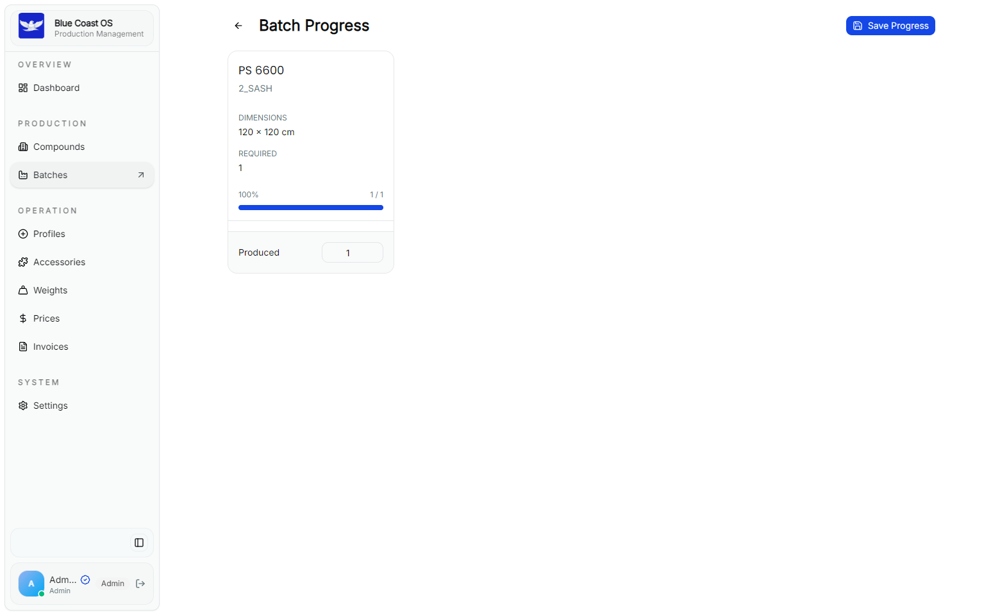
  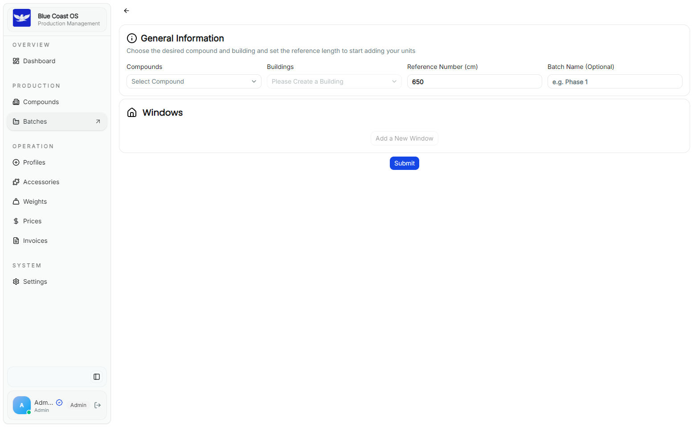
</p>

---

### 4. Technical Inventory & Master Data
Comprehensive catalogs maintaining engineering dimensions, cutting angles, and hardware specs.

<p align="center">
  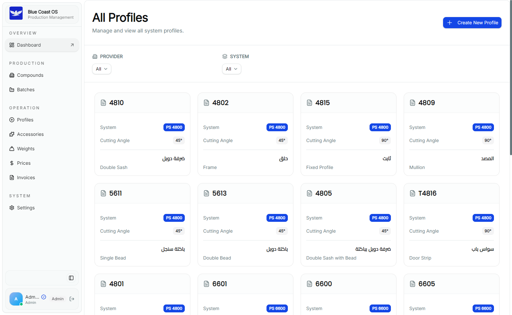
</p>

- **Profiles Catalog:** Extrusion library organized by system (e.g. *PS 4800*, *PS 6600*) with cutting angles ($45^\circ$, $90^\circ$).
- **Accessories Directory:** Comprehensive hardware inventory with standard units (`PCS`, `M`, `SET`, `KG`) and functional roles.
- **Profile Weights Matrix:** Maintain bar lengths (6.5m standard), linear weight per meter ($kg/m$), and individual bar weights.
- **Bulk Weight Matrix Entry:** High-speed bulk editor for updating profile weights across entire systems simultaneously.

<p align="center">
  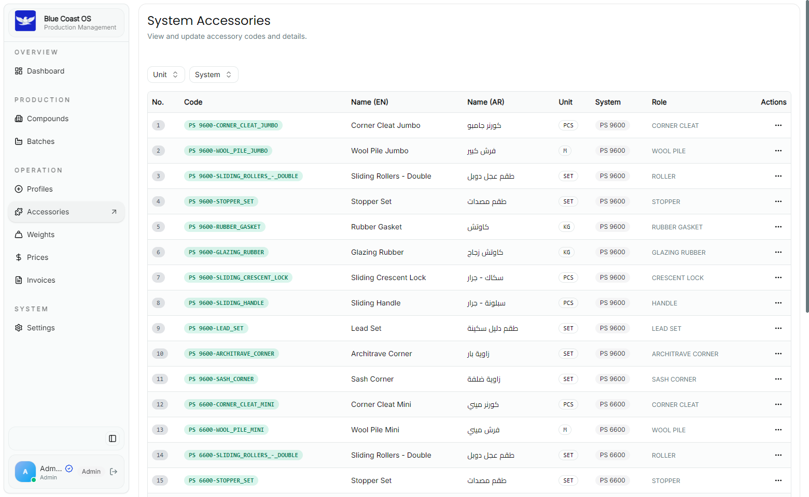
  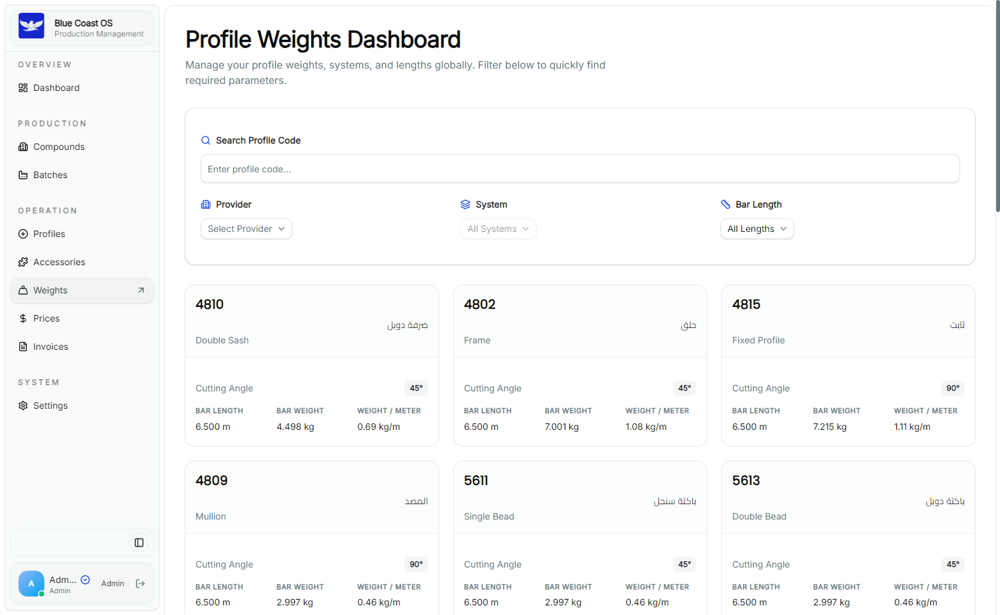
</p>

<p align="center">
  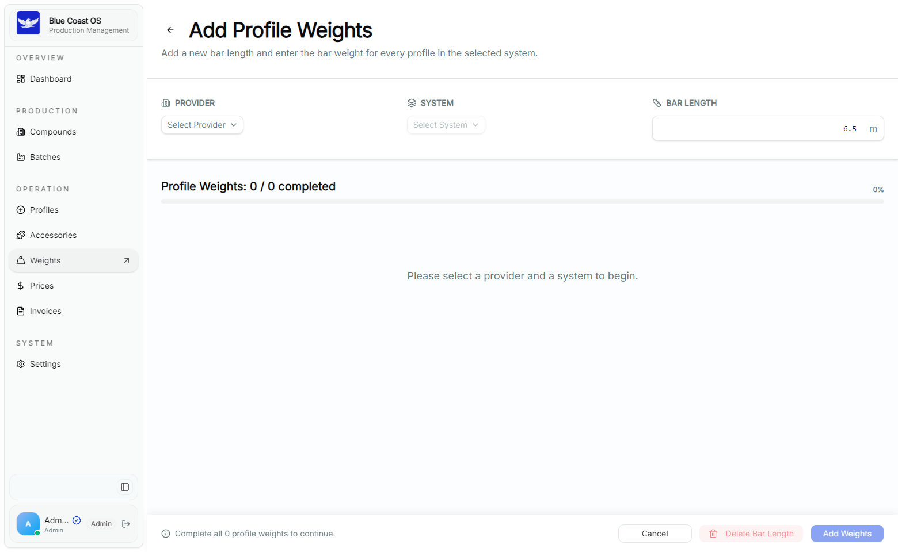
</p>

---

### 5. Pricing, Quoting & Invoices
Automate quotations and manage commercial billing directly from technical window configurations.

<p align="center">
  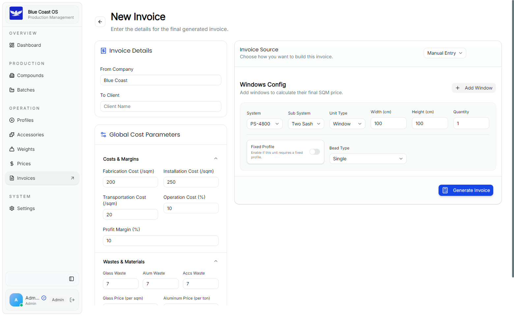
</p>

- **Parametric Window Estimator:** Specify window models (Two Sash, Fixed, Double Glazed), width, height, quantity, and bead type to dynamically calculate manufacturing cost and selling price per square meter.
- **Configurable Global Cost Parameters:**
  - Fabrication & installation costs per $m^2$
  - Logistics, transport & operational overhead percentages
  - Profit margin adjustments
  - Scrap & waste allowance ratios for glass, aluminum, and hardware
- **Invoices Ledger:** Historical order repository with invoice numbers, customer names, pending/paid status, totals, and PDF export.

<p align="center">
  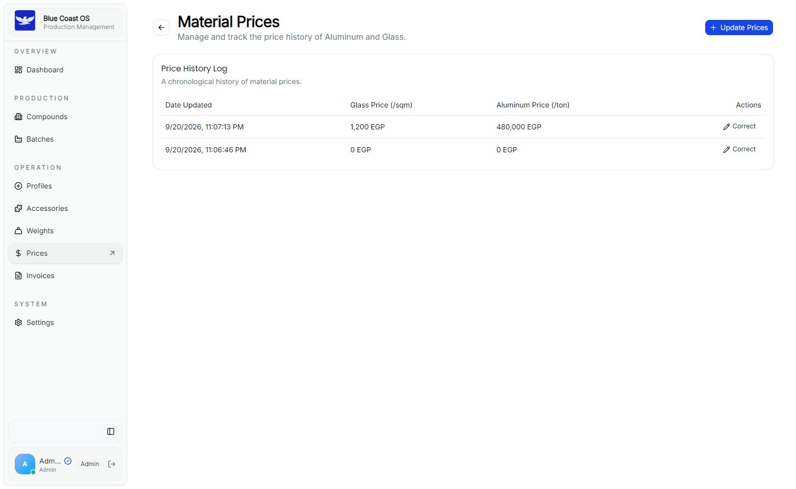
  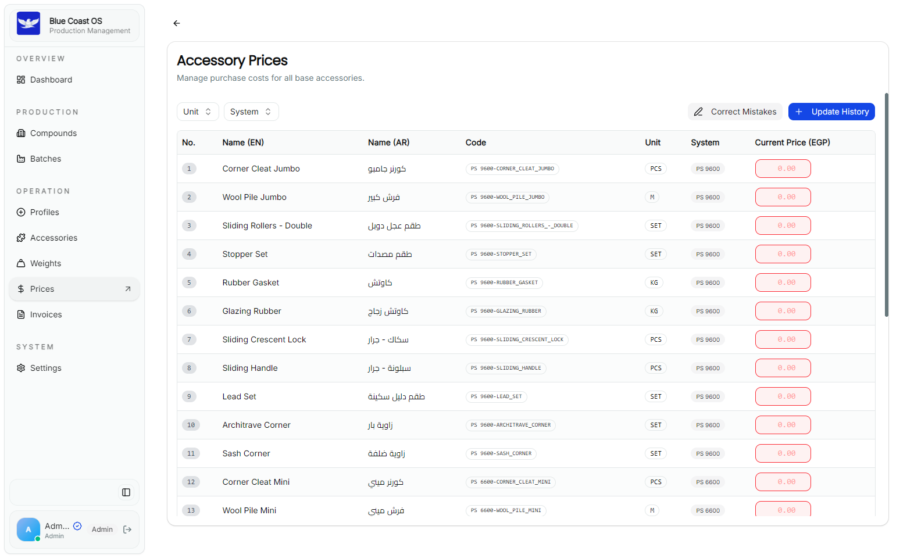
  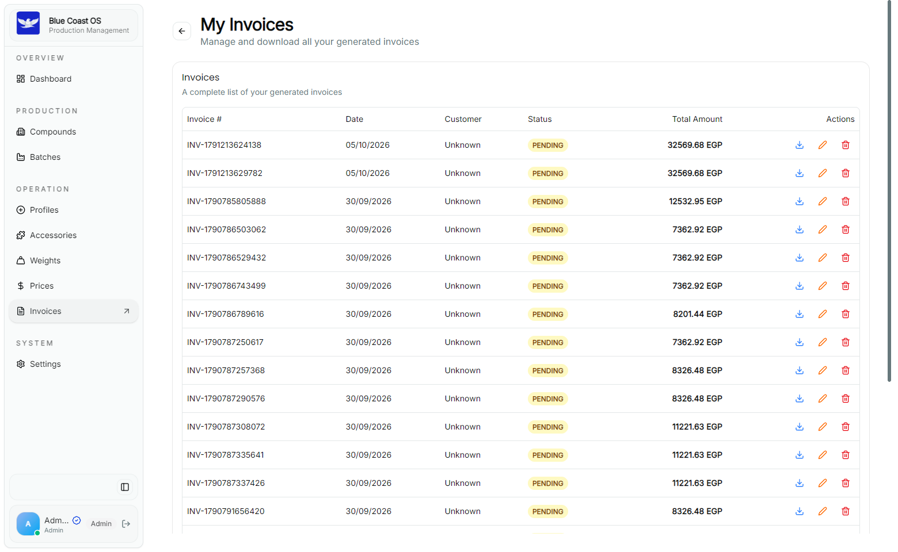
</p>

---

### 6. System Settings & Localization
Designed for industrial shop-floor and executive desktop environments alike.

<p align="center">
  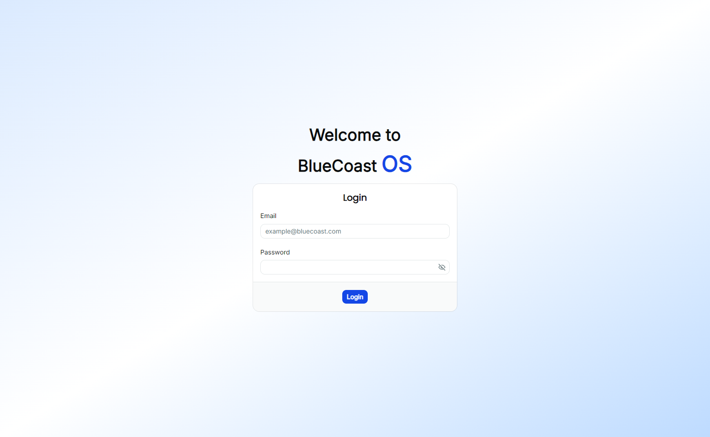
  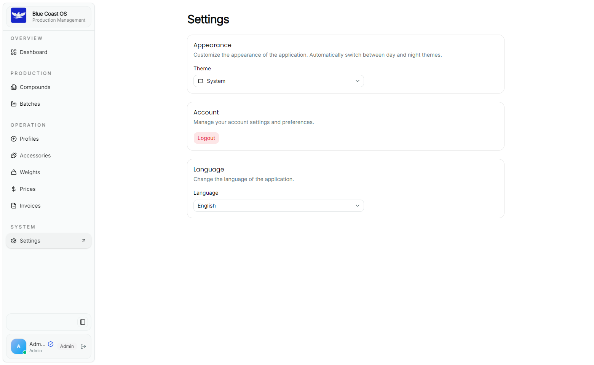
</p>

- **Bilingual Support:** Complete localization in English and Arabic with native RTL (Right-to-Left) layout transitions.
- **Theme Adaptability:** Dark mode, light mode, and system-adaptive themes.
- **Role-Based Access Control:** Role boundaries for Admin, Owner, and Operators.

---

## 🛠️ Architecture & Tech Stack

### Frontend (Desktop Client)
- **Runtime:** [Electron 30](https://www.electronjs.org/)
- **Framework:** [React 18](https://react.dev/) + [TypeScript](https://www.typescriptlang.org/)
- **Build Tool:** [Vite 5](https://vitejs.dev/) with `vite-plugin-electron`
- **Styling:** [TailwindCSS v4](https://tailwindcss.com/) + [Radix UI](https://www.radix-ui.com/) (shadcn/ui primitives)
- **State & Data Fetching:** [TanStack Query v5](https://tanstack.com/query) + [Zustand](https://github.com/pmndrs/zustand)
- **Routing:** [React Router v7](https://reactrouter.com/) (Hash-based navigation)
- **Charts:** [Recharts](https://recharts.org/)
- **Internationalization:** [i18next](https://www.i18next.com/) & [react-i18next](https://react.i18next.com/)

### Backend & Database
- **Server Framework:** [NestJS](https://nestjs.com/)
- **Database:** [PostgreSQL 16](https://www.postgresql.org/) with [TypeORM](https://typeorm.io/)
- **Optimization Algorithms:** Python cut plan calculation scripts integrated via child process pipelines
- **Deployment & Containers:** Docker, Docker Compose, Caddy Reverse Proxy

---

## 💻 Getting Started

### Prerequisites
- Node.js 18+
- npm or pnpm
- Docker & Docker Compose (for backend and database services)

### Installation & Setup

1. **Clone the repository:**
   ```bash
   git clone https://github.com/0xZeyad11/Blue-Coast-Desktop-Appliction.git
   cd Blue-Coast-Desktop-Appliction
   ```

2. **Install dependencies:**
   ```bash
   npm install
   ```

3. **Start Development Server:**
   ```bash
   npm run dev
   ```

4. **Package for Production:**
   ```bash
   npm run build
   ```

---

<p align="center">
  Developed by <strong>Zeyad Hesham</strong> • Blue Coast Industries
</p>
